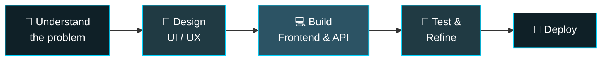

<div align="center">



<a href="https://git.io/typing-svg">
  
</a>

<br/>

[](https://www.linkedin.com/in/elang-argawana)
[](mailto:elangargawana.15@gmail.com)


</div>


## 👨‍💻 About Me

I'm an IT and Web/Mobile Developer from Semarang who enjoys building web and mobile applications, REST APIs, and the databases behind them. I like working with a structured approach: understanding the problem first, then building something clean and maintainable.

My journey into tech started a bit differently: I began as a video editor and designer, which is probably why I care so much about how an interface looks and feels. Today I work mostly with **Next.js** and **Laravel**, and I also build mobile apps with **Flutter**.

```js
const elang = {
  name: "Elang Argawana",
  role: "Frontend & Fullstack Developer",
  location: "Semarang, Central Java 🇮🇩",
  education: "D3 Informatics Engineering, Semarang State Polytechnic (GPA 3.82/4.00)",
  currentlyWorking: "Freelance Fullstack Developer",
  mainStack: ["Next.js", "React", "Laravel", "FastAPI", "Flutter"],
  background: "Video editing & design ➜ web development 🎬 ➜ 💻",
};
```


## 🔭 What I Do

- 🌐 **Build web apps & dashboards** with Next.js, React, Vue and Tailwind CSS
- ⚙️ **Develop REST APIs & databases** with Laravel, Node.js, FastAPI and MySQL
- 📱 **Create mobile apps** with Flutter, connected to my own backend APIs
- 🎨 **Turn Figma designs into code**, paying attention to layout, detail and animation
- 🎙️ **Share what I learn** by speaking at campus tech events (Figma parallax effects, RESTful APIs with Express)


## 🔄 How I Work




## 🛠️ Tech Stack

### 🌐 Frontend


### ⚙️ Backend


### 📱 Mobile


### 🗄️ Database & Tools


## 📊 GitHub Activity

<div align="center">


<br/><br/>

<picture>
  <source media="(prefers-color-scheme: dark)" srcset="https://raw.githubusercontent.com/elangargawana/elangargawana/output/github-snake-dark.svg" />
  <source media="(prefers-color-scheme: light)" srcset="https://raw.githubusercontent.com/elangargawana/elangargawana/output/github-snake.svg" />
  
</picture>

</div>


## 📫 Get in Touch

Feel free to reach out if you'd like to talk about web development, collaborate on something, or just say hi.

<div align="center">

[](https://www.linkedin.com/in/elang-argawana)
[](mailto:elangargawana.15@gmail.com)
[](https://wa.me/6282134081213)

<i>💡 "Code is like humor. When you have to explain it, it's bad."</i>

</div>
